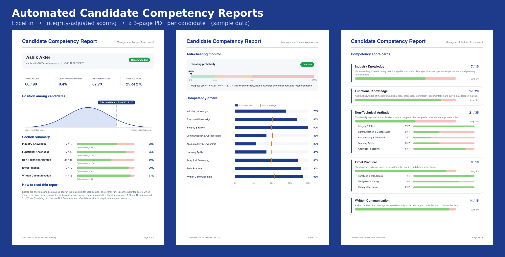

# Candidate Competency Report Generator

Turns raw online-assessment exports into a **branded, 3-page PDF competency report for every candidate**, with integrity-adjusted scoring and automatic ranking.

Built for high-volume recruitment drives where hundreds of candidates sit the same assessment and hiring managers need a consistent, readable report for each one, without anyone building them by hand.



> **All data in this repository is synthetic.** Names, emails (`@example.com`) and phone numbers are invented by `make_sample_data.py`. No real candidate data is included.

---

## What it does

1. **Reads two Excel exports**: question-level scores and a section summary. Column matching tolerates small header changes (case, spacing, punctuation).
2. **Cross-checks the files**: section totals are recalculated from question data, and phone numbers are shown only when both files agree (otherwise `N/A`).
3. **Adjusts for exam integrity** using the proctoring system's cheating probability:

   ```
   Weighted Score = Total Mark × (1 − Cheating Probability % / 100)
   ```

4. **Ranks and classifies** every candidate on the weighted score:

   | Rank | Recommendation |
   |---|---|
   | 1 – 50 | Recommended |
   | 51 – 200 | Promising |
   | 201+ | Not Recommended |
   | no integrity data | Not Ranked |

5. **Generates one PDF per candidate** plus an `_index.csv` summary of everyone.

## The report

| Page | Contents |
|---|---|
| 1 | Candidate details, recommendation, score tiles, position on a distribution curve, section summary vs cohort average |
| 2 | Anti-cheating monitor with risk band, and a 9-area competency profile vs cohort average |
| 3 | Detailed score cards for each section, with sub-competency breakdowns |

See [`sample_output/Sample_Candidate_Report.pdf`](Sample_Candidate_Report.pdf).

## Assessment structure (90 marks)

| Section | Marks | Questions |
|---|---|---|
| Industry Knowledge | 10 | 1–5 |
| Functional Knowledge | 20 | 6–15 |
| Non-Technical Aptitude (5 behavioural competencies) | 35 | 16–50 |
| Excel Practical | 10 | 51–55 |
| Written Communication | 15 | 56 |

The framework lives in the `SECTIONS` block of `generate_reports.py`, so it can be adapted to a different assessment by editing one list.

## Quick start

Requires Python 3.9+.

```bash
pip install -r requirements.txt
python make_sample_data.py      # creates 300 fake candidates in sample_data/
python generate_reports.py      # writes all PDFs to reports/
python generate_reports.py 5    # quick test: top 5 only
```

300 reports generate in well under a minute on an ordinary laptop.

## Using your own data

Edit the `SETTINGS` block at the top of `generate_reports.py`:

```python
RAW_FILE = HERE / "private_data" / "your_raw_scores.xlsx"
SUMMARY_FILE = HERE / "private_data" / "your_summary.xlsx"
RECOMMENDED_TOP = 50
PROMISING_TOP = 200
```

Keep real files in `private_data/`. It is listed in `.gitignore`, together with `reports/` and all other Excel/CSV files, so real candidate data cannot be committed by accident.

**Expected columns**
- *Raw file:* `Email`, `Phone Number`, `question_1` … `question_56`, `Total Mark (90)`
- *Summary file:* `Email`, `Name`, `Phone Number`, one column per section, `Total Mark (90)`, `Cheating Probability (%)`

## Project structure

```
├── generate_reports.py      # report generator
├── make_sample_data.py      # creates the synthetic sample data
├── requirements.txt
├── sample_data/             # fake Excel inputs
└── sample_output/           # example PDF and page images
```

## Tech

Python · pandas · openpyxl · ReportLab
